


 

## ⚡ Quién soy

Soy **Tristán Sánchez**, fundador y desarrollador full-stack de **[INFINIA AI](https://www.infinia.com.mx)**, un *AI-Native Systems Studio* hecho en México. Diseño, programo y opero los sistemas de punta a punta: desde la arquitectura y la seguridad hasta el último píxel y el despliegue.

> **No diseñamos páginas: diseñamos flujos de valor.** Construimos sistemas vivos, no entregables muertos.

## 🧠 Lo que construimos para tu negocio

<table>
<tr>
<td width="50%" valign="top">

**🌐 Sitios que venden** 
Landings rápidas con SEO local, calculadoras, 3D y agenda de citas. Hasta 100 en Lighthouse.

</td>
<td width="50%" valign="top">

**📱 Apps instalables (PWA)** 
Se instalan en iPhone y Android sin tienda de apps, con login de Google, NIP y huella.

</td>
</tr>
<tr>
<td valign="top">

**🧩 Sistemas a la medida** 
CRM, punto de venta, pantalla de cocina, agenda, expedientes y paneles del dueño en tiempo real.

</td>
<td valign="top">

**🤖 Agentes de IA para WhatsApp** 
Atienden, venden y agendan las 24 horas con n8n, Gemini y OpenAI conectados a tus datos.

</td>
</tr>
<tr>
<td valign="top">

**💳 Pagos e integraciones** 
Stripe, Mercado Pago, Shopify y Google Calendar con webhooks verificados.

</td>
<td valign="top">

**🛡️ Seguridad desde el diseño** 
Roles por permisos, 2FA, passkeys, reglas de mínimo privilegio y secretos fuera del código.

</td>
</tr>
</table>

## 👨‍💻 Modo código

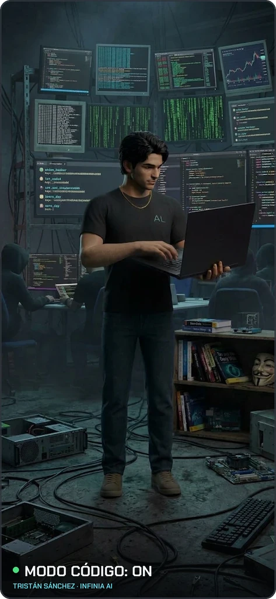

## 🛠️ Stack


## 🚀 Proyectos en producción


El código de estos proyectos es privado: pertenece a INFINIA AI y a sus clientes. Las capturas usan datos de prueba. Si quieres ver una demo, escríbeme.

## 🔐 Cómo trabajamos

| Principio | Cómo lo cumplimos |
|---|---|
| **Seguridad primero** | Cada acción del servidor verifica sesión y valida datos; reglas de base de datos probadas en emulador; secretos en Secret Manager. |
| **Rendimiento real** | Imágenes optimizadas, carga diferida y medición con Lighthouse antes de entregar. |
| **Costo mínimo** | Infraestructura serverless que escala a cero: pagas solo lo que se usa. |
| **Arquitectura que crece** | Monorepos con Turborepo y pnpm: varias apps que comparten diseño, datos y seguridad. |
| **IA con propósito** | La IA entra donde ahorra tiempo o vende más, con respaldo y control de costo. |
| **Listo es en producción** | Una tarea está terminada cuando se comprueba en producción, no cuando compila. |

## 🌎 Comunidad INFINIA AI


Estamos construyendo **la comunidad INFINIA AI**: un espacio para compartir proyectos de **código abierto para negocios** y lo que aprendemos al construir sistemas reales. Ya tenemos el panel donde compartimos los avances; síguenos en **[github.com/INFINIA-AI-MX](https://github.com/INFINIA-AI-MX)**.

 

### ¿Tienes un negocio y quieres llevarlo al siguiente nivel?

  

Powered by 
<a href="https://www.infinia.com.mx">

 
<picture>
  <source media="(prefers-color-scheme: dark)" srcset="assets/infinia-wordmark-blanco.png">
  
</picture>
</a>
 
Automatización · Inteligencia · Escalamiento

